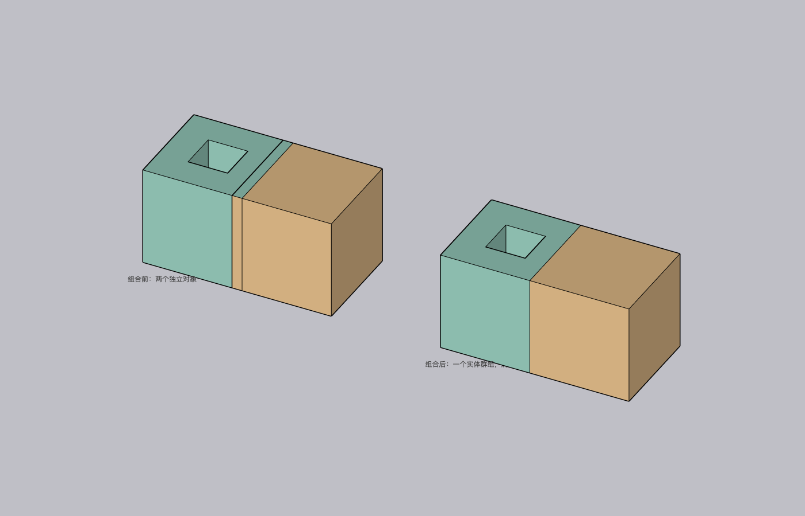

# Super Combine for SketchUp

[中文](README.md) · [Download](https://github.com/Lsc1123/sketchup-super-combine/releases/latest) · [Contributing](CONTRIBUTING.md)

An offline SketchUp extension that flattens selected nested groups/components, repairs recognizable planar gaps, and combines solids into one unnested group while preserving through-holes and sealed cavities.



## Install and use

Download the RBZ from [Releases](https://github.com/Lsc1123/sketchup-super-combine/releases/latest). In SketchUp, choose **Extensions → Extension Manager → Install Extension** and select the RBZ. Restart SketchUp after upgrading from an older version. The SHA256 checksum is supplied with each release.

Select groups or components in the same editing context, then use **超级组合** in the context menu, toolbar, or Extensions menu. One undo restores the sources after a successful operation. Failed operations preserve sources and selection.

## Version 1.0.1

Checks independent outer-shell directions and verifies that the result preserves input extents before deleting sources. A known mixed-orientation multi-shell case now rolls back instead of committing a result with missing geometry. Also fixes reentry protection and packages only listed runtime files, including project and third-party licenses.

The bounds check is a necessary check, not a general proof that arbitrary damaged geometry is correct. Disjoint solids remain separate closed bodies in one group; no bridges are invented. Tiny faces, tangency, self-intersection, nonplanar gaps, and ambiguous face orientations may be rejected. Glue/cut-opening components need real opening geometry first. Component links, nested hierarchy, and custom attributes are flattened. Editing inside a shared parent component follows SketchUp's normal instance propagation.

## Validation and development

Verified environments:

| Operating system | SketchUp version | Verification |
| --- | --- | --- |
| macOS arm64 | 2026 (26.0.428) | Repository native test suite passed |
| Windows 11 | 2025 | User-tested; reported working normally on 2026-11-01 |

The Windows result is user-reported and is separate from the automated macOS native suite. macOS / Windows CI covers Ruby geometry, guards, and packaging. No model data is sent over the network and no other extension is required.

Use Ruby 3.2 and Python 3.12:

```sh
ruby tools/check_syntax.rb
ruby tests/bsp_test.rb
ruby tests/entrypoint_test.rb
ruby tests/bounds_test.rb
python -m unittest discover -s tests -p "test_*.py" -v
python tools/package.py
```

See [native validation](docs/validation/v1.0.1/README.md) and the [historical 1.0.0 audit](docs/audit/2026-11-01/README.md). Run native scripts only in an isolated, disposable model. CI does not include SketchUp or its GUI.

MIT © 2026 LSC (Lsc1123). The BSP kernel adapts Evan Wallace's csg.js; its MIT attribution is preserved in `THIRD_PARTY_NOTICES.txt` and in the RBZ.
