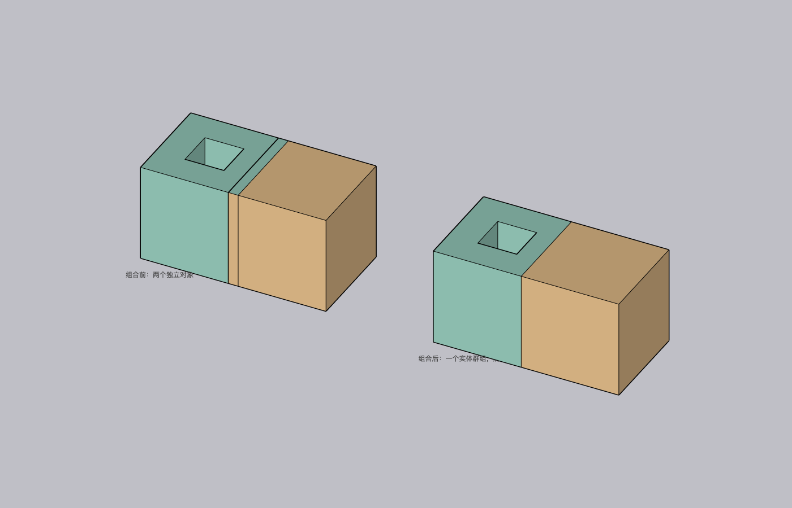

# 超级组合 · Super Combine

[English](README.en.md) · [下载安装包](https://github.com/Lsc1123/sketchup-super-combine/releases/latest) · [更新记录](CHANGELOG.md) · [参与开发](CONTRIBUTING.md)

[](https://github.com/Lsc1123/sketchup-super-combine/actions/workflows/ci.yml)
[](LICENSE)

独立的 SketchUp 扩展：选中群组或组件，一键展开嵌套、修补可识别的平面缺口、删除交叠内部面，输出一个无嵌套的实体群组，保留实际洞口和封闭空腔。离线运行，不发送模型数据，无其他插件依赖。



## 安装与使用

1. 从 [Releases](https://github.com/Lsc1123/sketchup-super-combine/releases/latest) 下载最新版 `.rbz`；校验和随包提供。
2. 在 SketchUp「扩展 → 扩展程序管理器 → 安装扩展」中选择安装包；从旧版升级后请重启 SketchUp 载入新版。
3. 在同一编辑层级选中群组或组件，使用右键、工具栏或「扩展 → 超级组合」中的「超级组合」。

成功后自动选中结果；按一次 **⌘Z / Ctrl+Z** 可恢复来源。失败时保留来源和选择。散线散面请先成组。

## 1.0.1 修复

- 先检查独立外壳方向，再校验结果范围，避免已确认的混合法线多壳体缺陷删除来源后丢失几何；歧义输入或异常结果会回滚并说明原因。
- 修复重入调用清除忙碌保护的问题。
- 统一版本来源，按运行文件清单构建，排除额外元数据；安装包包含项目 MIT 及第三方许可。

范围校验是必要的防错检查，不是任意破损模型的几何正确性证明。混合方向的独立壳体仍可能需要统一法线或分批处理。

## 处理范围与限制

支持普通实体并集、共面交接、重复实体、旋转 / 缩放 / 镜像嵌套、可识别的闭合共面缺口、孤立线、内部隔面、分散子组中的面拼合、贯通洞口、封闭空腔及空腔内独立体。另一实体实际占据空腔的部分按并集填入。

相离物体会成为同一群组中的多个封闭体，不自动搭桥。非共面缺口、复杂自交、极小面、相切及歧义法线可能无法修复；粘附切洞组件需先转为真实洞口几何。文字、尺寸和图片等需先移出；辅助点和辅助线不进入结果。

组合会展开组件关联、内部层级和自定义属性；面材质尽量保留，结果使用第一个选中对象的标签。顶层选择组件时，未选中的同定义来源实例不被展开修改；在共享父组件内部编辑时，父组件其他实例仍按 SketchUp 正常语义联动。

## 兼容与验证

已验证的运行环境：

| 系统 | SketchUp 版本 | 验证方式与结果 |
| --- | --- | --- |
| macOS arm64 | 2026（26.0.428） | 仓库原生测试通过 |
| Windows 11 | 2025 | 用户实测反馈：可以正常运行（2026-11-01） |

详细记录见 [1.0.1 发布验证](docs/validation/v1.0.1/README.md)。macOS / Windows CI 覆盖纯 Ruby 内核、入口保护、范围校验和打包；Windows 11 / SketchUp 2025 的记录来自用户实测反馈，不计入 macOS 原生自动化测试数量。

CI 不包含 SketchUp 宿主或 GUI。历史 [1.0.0 首轮审查](docs/audit/2026-11-01/README.md)保留原缺陷前后模型及证据；不能把历史失败结果当作当前版本状态。

## 开发与构建

CI 使用 Ruby 3.2、Python 3.12；不需要其他 gem 或 Python 包。

```sh
ruby tools/check_syntax.rb
ruby tests/bsp_test.rb
ruby tests/entrypoint_test.rb
ruby tests/bounds_test.rb
python -m unittest discover -s tests -p "test_*.py" -v
python tools/package.py
```

产物位于 `dist/`。单一版本来源是 `src/lsc_super_combine/version.rb`；运行文件清单位于 `tools/package_manifest.json`。原生测试须在独立、可丢弃的空白文档运行，详见 [贡献指南](CONTRIBUTING.md)。

## 许可证

[MIT License](LICENSE)，Copyright © 2026 LSC (Lsc1123)。BSP 内核改编自 Evan Wallace 的 csg.js，来源与 MIT 文本保留在 `THIRD_PARTY_NOTICES.txt`，随 RBZ 分发。
